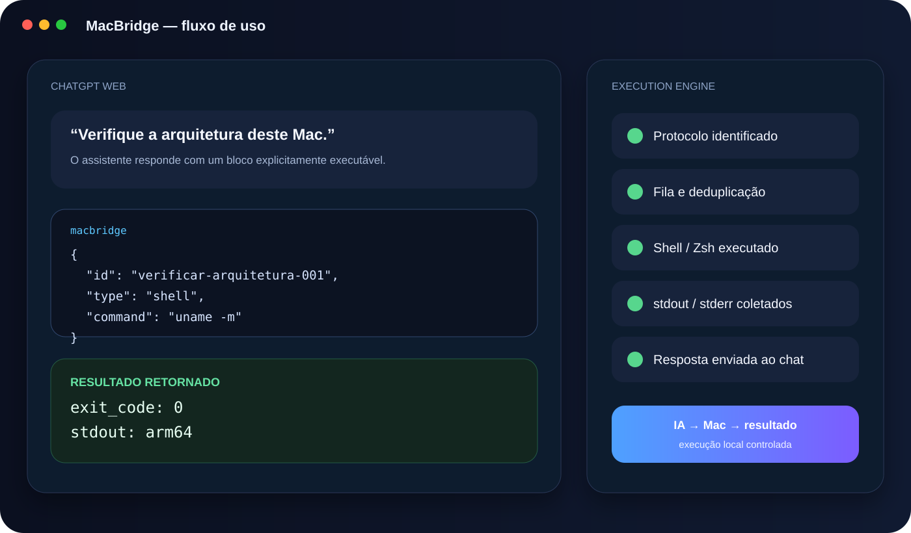
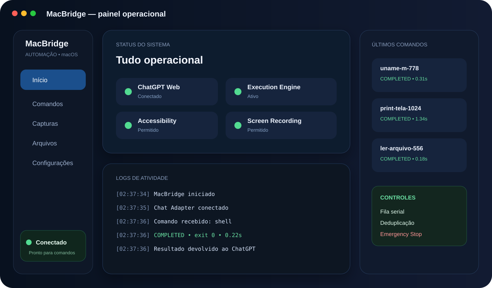
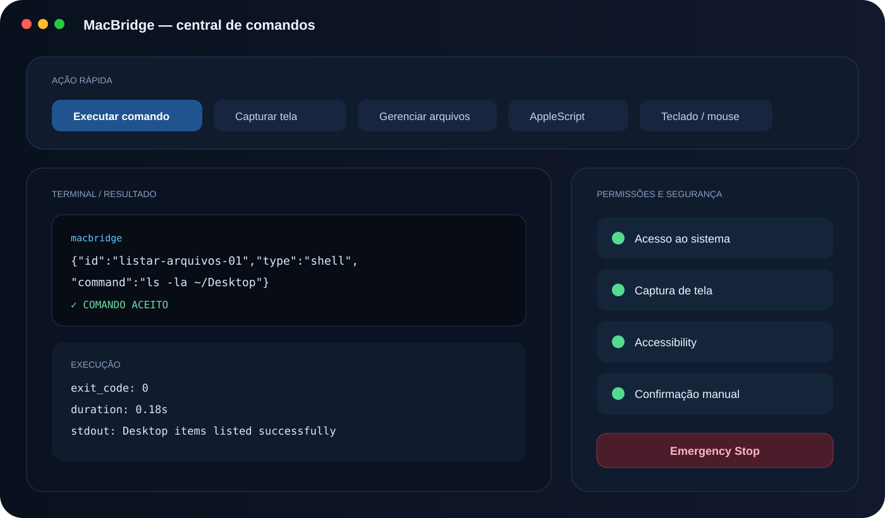

# MacBridge

<p align="center">
  <strong>Uma ponte entre o ChatGPT Web e ações locais autorizadas no macOS.</strong>
</p>

<p align="center">
  <code>SwiftUI</code> · <code>WKWebView</code> · <code>JavaScript</code> · <code>Shell/Zsh</code> · <code>AppleScript</code> · <code>Automação macOS</code>
</p>



> **Nota sobre as imagens:** os visuais abaixo são ilustrações técnicas do fluxo e da interface, baseadas no comportamento real do projeto. Não são apresentados como screenshots fotográficos da build atual. O aplicativo funcional é instalado como **MacBridge.app**; o target/projeto mantém internamente o nome histórico **MacBridge2**.

## Sobre o projeto

**MacBridge** é um aplicativo nativo para macOS criado para transformar o ChatGPT Web em uma interface capaz de solicitar ações locais estruturadas no computador. O app mantém uma sessão web persistente, identifica comandos explicitamente marcados, executa apenas as classes de ações habilitadas e devolve o resultado da execução para a conversa.

A proposta é reduzir a distância entre **conversar com uma IA** e **executar tarefas reais no Mac**, mantendo o usuário no controle das permissões e do protocolo utilizado.

## O problema que ele resolve

Normalmente, uma conversa no navegador não consegue agir diretamente sobre arquivos, aplicativos, janelas ou comandos locais do macOS. O MacBridge adiciona uma camada local de execução controlada:

```text
ChatGPT Web
    │
    ▼
MacBridge / WKWebView
    │
    ├── interpreta protocolo estruturado
    ├── valida tipo de ação
    ├── enfileira e deduplica comandos
    ▼
Execution Engine
    │
    ├── shell / zsh
    ├── AppleScript
    ├── aplicativos
    ├── screenshots
    ├── arquivos / clipboard
    └── teclado / mouse
    │
    ▼
Resultado retornado ao ChatGPT
```

## Demonstração visual

### Ponte entre a conversa e o Mac


O fluxo central combina a sessão do ChatGPT com status do sistema, histórico de comandos e ações locais. A intenção de design é permitir que o usuário acompanhe o que foi solicitado e o que foi realmente executado.

### Painel de automação



O painel reúne conexão, automação, captura de tela, acesso ao sistema e logs em uma visão única.

### Central de comandos



A central de comandos representa o modelo operacional do projeto: comandos estruturados, status de execução, terminal/logs e atalhos para recursos do sistema.

## Principais recursos

- **Sessão persistente do ChatGPT Web** dentro de um `WKWebView`.
- **Protocolo estruturado `macbridge`** para diferenciar texto normal de ações executáveis.
- Execução de **Shell/Zsh** e **AppleScript**.
- Abertura de aplicativos do macOS.
- Captura de tela e retorno do resultado para a conversa.
- Leitura e escrita de arquivos.
- Leitura e escrita da área de transferência.
- Automação de teclado e mouse.
- **Fila serial** para evitar concorrência indevida.
- **Deduplicação** para impedir a execução repetida do mesmo comando na mesma sessão.
- Retorno de `stdout`, `stderr`, código de saída e duração da execução.
- **Emergency Stop** para encerrar processos filhos e esvaziar a fila.
- Logs locais para diagnóstico e auditoria.
- Classes de ação habilitáveis/desabilitáveis nas configurações.
- Modo de confirmação manual para operações que exigem maior controle.

## Exemplo de uso

Uma solicitação de execução é emitida de forma explícita:

```macbridge
{
  "id": "verificar-arquitetura-001",
  "type": "shell",
  "command": "uname -m"
}
```

O MacBridge identifica o bloco, executa localmente e devolve o resultado para a conversa. O mesmo modelo é utilizado para capturas de tela, leitura de arquivos, AppleScript e automações de interface.

## Tipos de ação suportados

| Tipo | Finalidade |
| --- | --- |
| `shell` | Executar comando local |
| `applescript` | Automatizar apps e recursos do macOS |
| `openapp` | Abrir aplicativo |
| `screenshot` | Capturar tela ou janela |
| `clipboardread` | Ler área de transferência |
| `clipboardwrite` | Escrever na área de transferência |
| `fileread` | Ler arquivo |
| `filewrite` | Criar ou alterar arquivo |
| `keypress` | Enviar combinação de teclas |
| `typetext` | Digitar texto |
| `mouseclick` | Executar clique |
| `mousemove` | Mover o ponteiro |

## Arquitetura

| Camada | Tecnologia / responsabilidade |
| --- | --- |
| Interface | SwiftUI |
| Navegação web | WKWebView persistente |
| Integração com a conversa | `ChatAdapter.js` + `MutationObserver` |
| Parsing | `CommandParser` |
| Execução | `ExecutionEngine` |
| Automação | Shell/Zsh, AppleScript, Accessibility APIs |
| Controle de fluxo | fila serial + deduplicação |
| Diagnóstico | logs locais + resultado estruturado |

## Segurança e controle

O MacBridge foi desenhado para executar **somente blocos explicitamente marcados como comandos**. A navegação embutida é restrita aos domínios necessários para a sessão, links externos podem ser abertos fora do WebView e cada classe de ação pode ser desativada.

O aplicativo também possui **Emergency Stop** para interromper processos em execução e limpar a fila. Como o objetivo é automação local ampla, o projeto não utiliza o modelo tradicional de sandbox da Mac App Store.

## Desenvolvimento e build

O projeto é desenvolvido em Swift/Xcode. O produto atual é instalado como:

```text
/Applications/MacBridge.app
```

O projeto Xcode/target mantém o nome histórico `MacBridge2`. Para recursos de automação, o macOS pode solicitar permissões de **Acessibilidade** e **Gravação da Tela**.

## O que este projeto demonstra

O MacBridge reúne competências de desenvolvimento que normalmente aparecem separadas:

- desenvolvimento nativo para macOS com SwiftUI;
- integração de conteúdo web em aplicativo nativo;
- comunicação JavaScript ↔ Swift;
- parsing de protocolo estruturado;
- execução e supervisão de processos;
- automação de sistema;
- manipulação de arquivos e clipboard;
- captura de tela;
- controle de concorrência e deduplicação;
- tratamento de permissões e segurança operacional;
- design de interface para ferramentas técnicas.

## Autor

**Pedro Santos**  
GitHub: [@RealPedroSantos](https://github.com/RealPedroSantos)

---

Projeto de portfólio em evolução. O foco do MacBridge é explorar uma experiência de IA conectada ao macOS com execução local controlada, observável e reversível.
