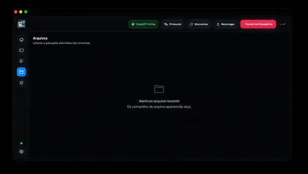
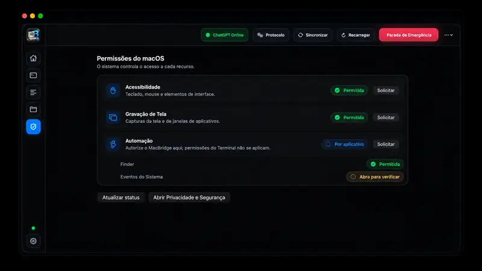

# MacBridge

<p align="center">
  <strong>Uma ponte entre o ChatGPT Web e ações locais autorizadas no macOS.</strong>
</p>

<p align="center">
  <code>SwiftUI</code> · <code>WKWebView</code> · <code>JavaScript</code> · <code>Shell/Zsh</code> · <code>AppleScript</code> · <code>Automação macOS</code>
</p>

<p align="center">
  <strong>Desenvolvido por <a href="https://github.com/RealPedroSantos">RealPedroSantos</a></strong><br/>
  Pedro Santos
</p>

## Download

O **instalador atual do MacBridge para macOS ainda não está publicado neste repositório**.

Não é disponibilizada uma build antiga como se fosse a versão atual. Quando o `.dmg` da build atual for publicado, esta seção passará a oferecer o download direto do instalador.

**Distribuição prevista:** `MacBridge.dmg` para macOS 14 ou superior.

## Sobre o projeto

**MacBridge** é um aplicativo nativo para macOS criado para transformar o ChatGPT Web em uma interface capaz de solicitar ações locais estruturadas no computador. O app mantém uma sessão web persistente, identifica comandos explicitamente marcados, executa apenas as classes de ações habilitadas e devolve o resultado da execução para a conversa.

A proposta é reduzir a distância entre **conversar com uma IA** e **executar tarefas reais no Mac**, mantendo o usuário no controle das permissões e do protocolo utilizado.

## Demonstração real do aplicativo

As imagens abaixo são capturas da **interface real do MacBridge**. Informações técnicas internas, identificadores de execução e conteúdo de logs foram ocultados nas imagens públicas quando necessário para preservar privacidade, sem alterar a interface apresentada.

### Tela principal — ChatGPT integrado ao MacBridge


A tela principal reúne o ChatGPT, múltiplos chats/provedores, status do sistema, histórico recente de comandos e o controle de **Parada de Emergência**.

### Execuções — comandos e resultados


O painel de **Execuções** permite acompanhar os comandos recebidos, estado da execução, duração e código de saída. Identificadores internos foram ocultados na imagem pública.

### Logs — diagnóstico e auditoria local


A área de **Logs** registra o ciclo de comunicação e execução do MacBridge. UUIDs, comandos detalhados, timestamps e outros identificadores técnicos foram borrados nesta demonstração pública.

### Arquivos — leitura e gravação solicitadas pela conversa



A área de **Arquivos** centraliza leituras e gravações solicitadas durante as conversas, permitindo que o usuário acompanhe operações de arquivo realizadas pelo bridge.

### Permissões do macOS



O MacBridge apresenta de forma explícita o estado das permissões de **Acessibilidade**, **Gravação de Tela** e **Automação**, mantendo o usuário no controle dos recursos liberados ao aplicativo.

## O problema que ele resolve

Normalmente, uma conversa no navegador não consegue agir diretamente sobre arquivos, aplicativos, janelas ou comandos locais do macOS. O MacBridge adiciona uma camada local de execução controlada:

```text
ChatGPT Web
    │
    ▼
MacBridge / WKWebView
    │
    ├── interpreta protocolo estruturado
    ├── valida tipo de ação
    ├── enfileira e deduplica comandos
    ▼
Execution Engine
    │
    ├── shell / zsh
    ├── AppleScript
    ├── aplicativos
    ├── screenshots
    ├── arquivos / clipboard
    └── teclado / mouse
    │
    ▼
Resultado retornado ao ChatGPT
```

## Principais recursos

- **Sessão persistente do ChatGPT Web** dentro de um `WKWebView`.
- Suporte a múltiplos chats e provedores, incluindo ChatGPT e Gemini.
- **Protocolo estruturado `macbridge`** para diferenciar texto normal de ações executáveis.
- Execução de **Shell/Zsh** e **AppleScript**.
- Abertura de aplicativos do macOS.
- Captura de tela e retorno do resultado para a conversa.
- Leitura e escrita de arquivos.
- Leitura e escrita da área de transferência.
- Automação de teclado e mouse.
- **Fila serial** para evitar concorrência indevida.
- **Deduplicação** para impedir a execução repetida do mesmo comando na mesma sessão.
- Retorno de `stdout`, `stderr`, código de saída e duração da execução.
- **Emergency Stop** para encerrar processos filhos e esvaziar a fila.
- Logs locais para diagnóstico e auditoria.
- Classes de ação habilitáveis/desabilitáveis nas configurações.
- Modo de confirmação manual para operações que exigem maior controle.

## Exemplo de uso

Uma solicitação de execução é emitida de forma explícita:

```macbridge
{
  "id": "verificar-arquitetura-001",
  "type": "shell",
  "command": "uname -m"
}
```

O MacBridge identifica o bloco, executa localmente e devolve o resultado para a conversa. O mesmo modelo é utilizado para capturas de tela, leitura de arquivos, AppleScript e automações de interface.

## Tipos de ação suportados

| Tipo | Finalidade |
| --- | --- |
| `shell` | Executar comando local |
| `applescript` | Automatizar apps e recursos do macOS |
| `openapp` | Abrir aplicativo |
| `screenshot` | Capturar tela ou janela |
| `clipboardread` | Ler área de transferência |
| `clipboardwrite` | Escrever na área de transferência |
| `fileread` | Ler arquivo |
| `filewrite` | Criar ou alterar arquivo |
| `keypress` | Enviar combinação de teclas |
| `typetext` | Digitar texto |
| `mouseclick` | Executar clique |
| `mousemove` | Mover o ponteiro |

## Arquitetura

| Camada | Tecnologia / responsabilidade |
| --- | --- |
| Interface | SwiftUI |
| Navegação web | WKWebView persistente |
| Integração com a conversa | `ChatAdapter.js` + `MutationObserver` |
| Parsing | `CommandParser` |
| Execução | `ExecutionEngine` |
| Automação | Shell/Zsh, AppleScript, Accessibility APIs |
| Controle de fluxo | fila serial + deduplicação |
| Diagnóstico | logs locais + resultado estruturado |

## Segurança e controle

O MacBridge foi desenhado para executar **somente blocos explicitamente marcados como comandos**. A navegação embutida é restrita aos domínios necessários para a sessão, links externos podem ser abertos fora do WebView e cada classe de ação pode ser desativada.

O aplicativo também possui **Emergency Stop** para interromper processos em execução e limpar a fila. Como o objetivo é automação local ampla, o projeto não utiliza o modelo tradicional de sandbox da Mac App Store.

## Desenvolvimento e build

O projeto é desenvolvido em Swift/Xcode. O produto atual é instalado como:

```text
/Applications/MacBridge.app
```

O código fonte atual está organizado como projeto Xcode e a interface utiliza SwiftUI. Para recursos de automação, o macOS pode solicitar permissões de **Acessibilidade**, **Gravação da Tela** e **Automação**.

## Autoria

**Desenvolvido por RealPedroSantos**  
**Pedro Santos**  
GitHub: [@RealPedroSantos](https://github.com/RealPedroSantos)

A identidade de autoria também deve permanecer registrada no aplicativo, na área **Sobre**, e no metadata/copyright do bundle macOS.

---

Projeto de portfólio em evolução. O foco do MacBridge é explorar uma experiência de IA conectada ao macOS com execução local controlada, observável e reversível.
